# 🌐 Smart Web Experience: TF Telecom

<p>
  
  
  
  
  
  
  
</p>

Site responsivo da **TF Telecom**, provedor de internet fibra em **Chapecó (SC)**. Foi feito no **Framer** (no-code) e personalizado com **HTML, CSS e JavaScript**. Traz um **assistente com IA** que recomenda o plano ideal e classifica as solicitações de atendimento.

🔗 **Link público:** https://tftelecom-chapeco.framer.website
🎥 **Vídeo pitch:** https://www.loom.com/share/e0c9a8555d1f48cfb9e181c093c4c4e8

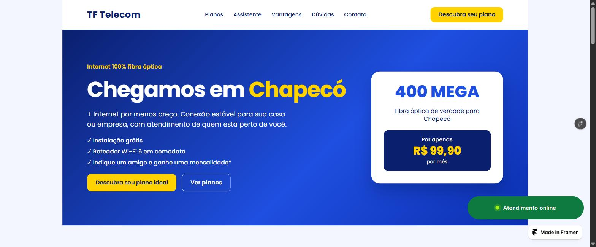

---

## O problema
Os clientes da TF Telecom só encontravam informações básicas nas redes sociais. Para escolher um plano, pedir 2ª via ou avisar que a internet caiu, precisavam chamar no WhatsApp e esperar alguém fazer a triagem manual. O resultado era atendimento lento, mensagens misturadas e vendas perdidas fora do horário comercial.

## A solução
| Funcionalidade | O que faz |
|---|---|
| Site institucional | Hero, planos (400 Mega R$ 99,90 · 500 Mega R$ 119,90 · 600 Mega R$ 129,90), vantagens, dúvidas frequentes e contato |
| **Recomendador de planos** | Quiz de 4 perguntas. Calcula a demanda de banda, recomenda o plano, explica o motivo e respeita o orçamento |
| **Classificador de solicitações com IA** | Modelo Naive Bayes treinado no navegador. Entende a mensagem mesmo com erros de digitação, identifica o assunto (Suporte, Financeiro, Nova contratação, Mudança/cadastro), a prioridade e a confiança, mostra as palavras que pesaram, gera protocolo e envia ao setor certo no WhatsApp |
| Botão de WhatsApp com status | Mostra em tempo real se o atendimento está aberto (horário de Brasília) e se atualiza a cada minuto |
| Menu no celular | Botão ☰ que abre um painel com todos os links e fecha ao escolher uma seção |
| Registro de leads (opcional) | Webhook para Make/Zapier/n8n salvar leads e solicitações numa planilha |
| **Acessibilidade para deficientes visuais** | Leitura em voz alta das perguntas e resultados, ditado por voz da mensagem, aumento de fonte (até 160%) e modo alto contraste, com as preferências salvas no navegador |
| SEO local | Dados estruturados (JSON-LD) de provedor de internet em Chapecó |

## Como foi construído
1. **IA + no-code:** a estrutura do site (seções, textos, cores, âncoras e versões para computador, tablet e celular) foi gerada pelo **Agent de IA do Framer**, a partir de um briefing em português.
2. **Editor visual:** ajustes no painel do Framer: posição fixa do botão de WhatsApp, idioma pt-BR, descrição para o Google, subdomínio e redução de animações.
3. **Código próprio:** dois componentes **Embed** com HTML, CSS e JavaScript: o assistente com IA e o botão de WhatsApp com status.

## Tecnologias e ferramentas
- **Framer**: layout, breakpoints, hospedagem e publicação.
- **HTML5**: estrutura semântica, `fieldset`/`legend`/`label`, ARIA (`tablist`, `aria-live`, `aria-selected`, `aria-expanded`), `details/summary` no FAQ.
- **CSS3**: variáveis, Grid `auto-fit`, `clamp()`, `:has()`, `:focus-visible`, pseudo-elementos para o logo em marca d'água, media queries e `prefers-reduced-motion`.
- **Web Speech API**: `speechSynthesis` (leitura em voz alta) e `SpeechRecognition` (ditado) em pt-BR.
- **JavaScript**: quiz, algoritmo de recomendação, **Naive Bayes multinomial**, distância de Levenshtein, bigramas, `fetch` (webhook), `Intl`, fuso `America/Sao_Paulo`.
- **Integrações**: WhatsApp (`wa.me`) e webhook opcional (Make).
- **Qualidade**: testes automatizados com Playwright (`testes/`).

## Personalizações (além dos componentes do Framer)
1. **`assistente-tf.html`**: abas acessíveis, quiz em etapas, resultado no formato "etiqueta de preço" dos anúncios, identidade visual da marca e logo atrás do painel.
2. **`botao-whatsapp-status.html`**: detecta se está dentro do iframe do Framer e se adapta.
3. **`seo-head.html`**: meta tags, Open Graph e JSON-LD.

## Recurso inteligente
- **Recomendação:** `demanda = pessoas × 2 + peso das atividades (+4 se empresa)`. A faixa de demanda define o plano, e o orçamento pode ajustar a sugestão.
- **Classificação (IA):** o texto passa por normalização, remoção de palavras vazias, correção de erros de digitação (Levenshtein), radicais e bigramas, e por fim pelo **Naive Bayes** com suavização de Laplace. Abaixo de 45% de confiança, a mensagem vai para "Atendimento geral".
- **Resultado medido** em 26 frases que o modelo nunca viu:

| Versão | Acurácia |
|---|---|
| v1: palavras-chave | 73% |
| **v2: Naive Bayes** | **92%** |

  Urgência detectada corretamente em 100% dos casos. Detalhes em [`testes/RESULTADOS.md`](testes/RESULTADOS.md).
- **Privacidade (LGPD):** a análise roda no navegador. Nada é enviado até o cliente clicar no WhatsApp.

## Prints
| | Desktop | Celular |
|---|---|---|
| Site | 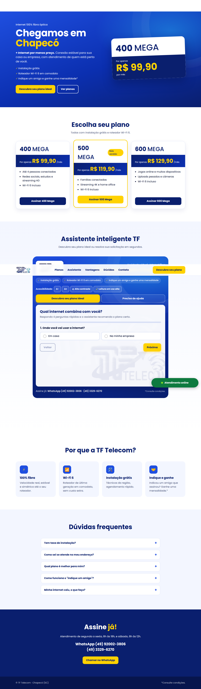 |  |
| Quiz | 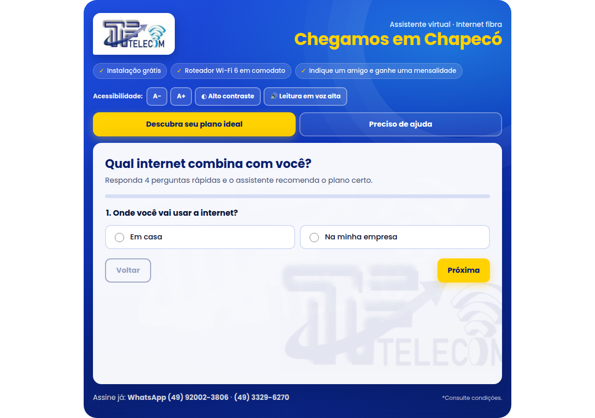 | 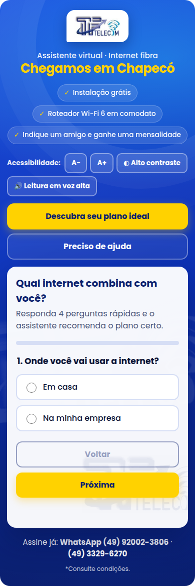 |
| Recomendação |  | 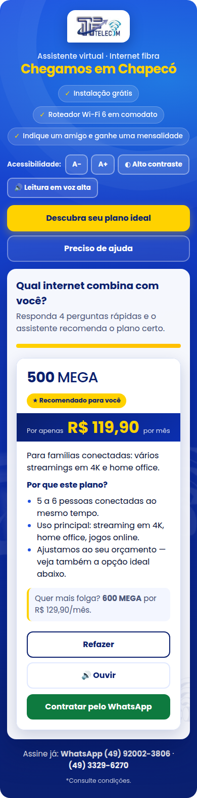 |
| Classificador | 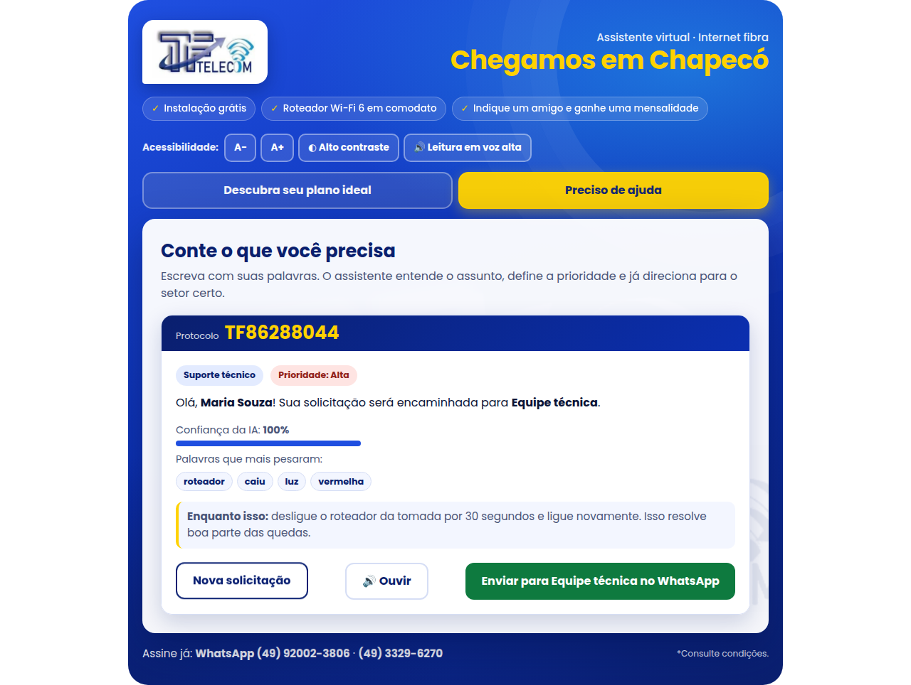 | 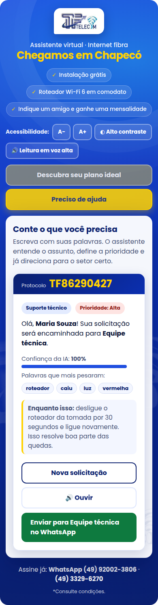 |
| Alto contraste + fonte 140% | 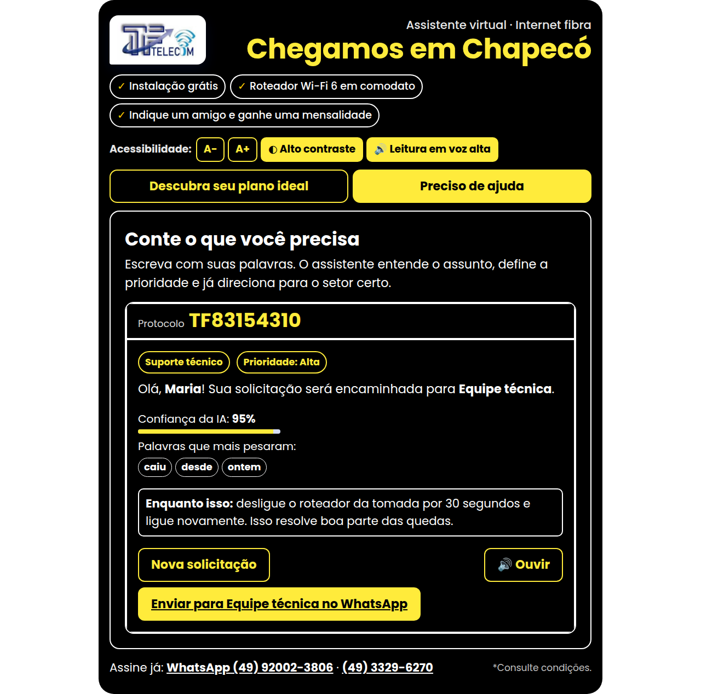 | 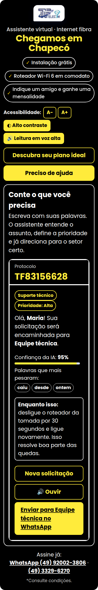 |

### Site publicado no Framer
| Início | Planos | Assistente | Celular |
|---|---|---|---|
|  | 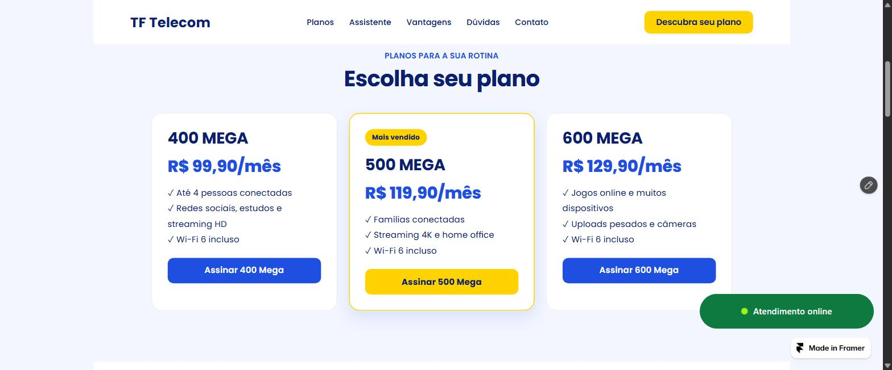 | 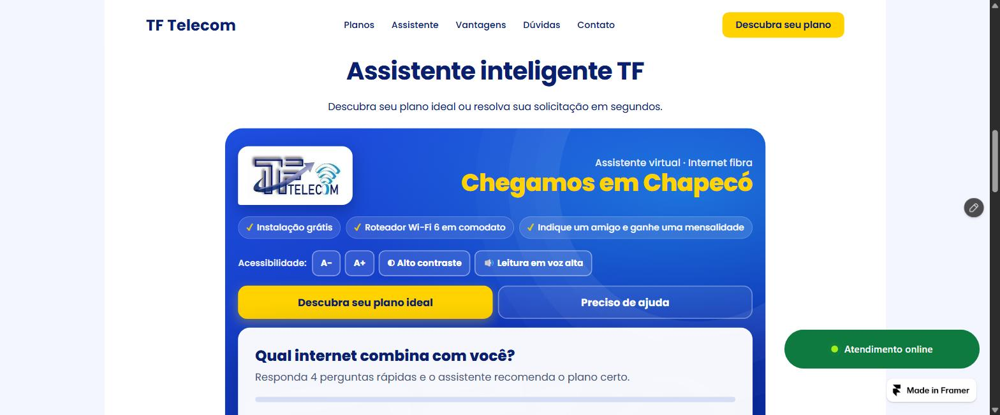 | 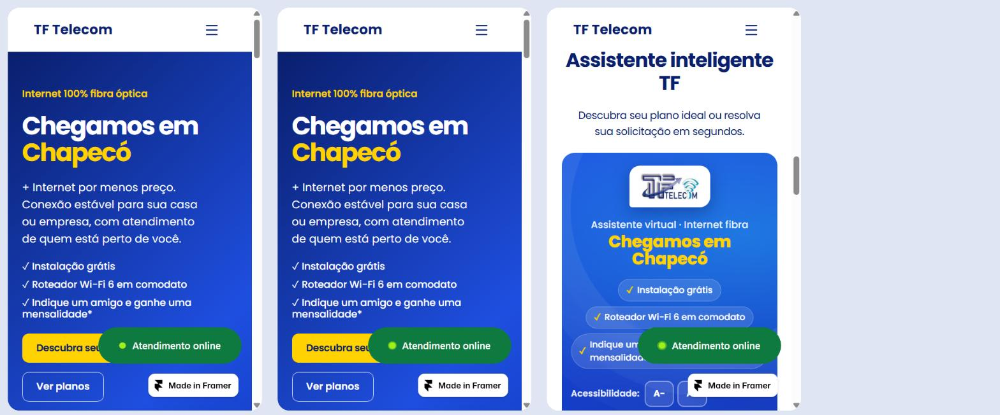 |

## Como testar
1. Acesse o link público.
2. Em **Descubra seu plano**, responda às 4 perguntas.
3. Em **Preciso de ajuda**, teste frases como:
   - "minha internete caiu" → Suporte técnico, prioridade Alta (mesmo com erro de digitação)
   - "preciso da segunda via do bolto" → Financeiro
   - "vocês instalam no bairro Efapi?" → Nova contratação
   - "vou me mudar semana que vem" → Mudança / cadastro
4. Clique no WhatsApp e veja a mensagem pronta, com categoria, prioridade e protocolo.
5. Acessibilidade: ative **🔊 Leitura em voz alta** e responda ao quiz ouvindo as perguntas. Teste **A+** e **Alto contraste**. (O 🎤 ditado funciona no arquivo aberto direto no Chrome; no site do Framer o microfone é bloqueado pelo iframe, e o botão avisa o cliente.) Navegue só com Tab e Enter.

Sem internet/Framer: abra `prototipo/site-completo.html` no navegador (com a pasta inteira baixada).

## Uso de IA no desenvolvimento
O Framer Agent gerou a estrutura inicial das seções, e o assistente Claude (Anthropic) apoiou a escrita e a revisão do código, os testes e a documentação. As decisões do projeto e a revisão final são do autor. Detalhes no Apêndice A da parte teórica.

## Estrutura
```
smart-web-tftelecom/
├── README.md · CHECKLIST_ENTREGA.md · GUIA_MONTAGEM_FRAMER.md
├── Parte_Teorica_TF_Telecom.docx / .pdf (padrão ABNT) · Roteiro_Video_Pitch.md
├── codigo-framer/   assistente-tf.html · botao-whatsapp-status.html · seo-head.html
├── prototipo/       site-completo.html (modelo do site) · logo-tf.webp
├── testes/          avaliar_classificador.py · RESULTADOS.md
└── prints/
```

---

Trabalho da disciplina **Padrões Web para No Code e Low Code** (nota 10) · Graduação Tecnológica em Inteligência Artificial e Automação Digital · **UniFECAF** · Feito por [Thiago Felipe Oliveira](https://www.linkedin.com/in/thiagofelipeoliveira)
